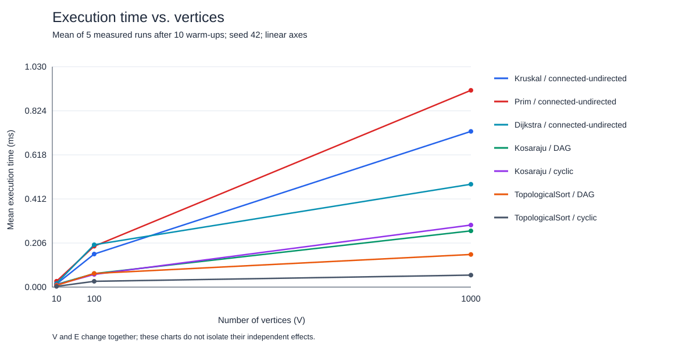
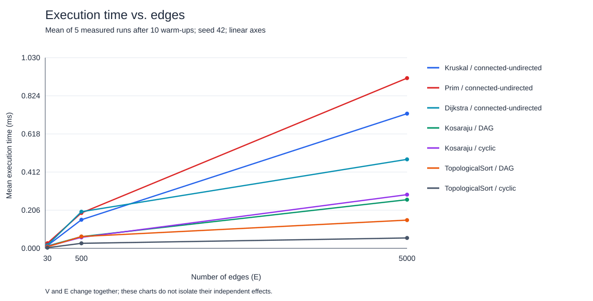

# Assignment 3 — Smart City Infrastructure and Route Planning

## Overview

This Java project models city districts as vertices and roads as edges. Road weights represent construction costs for minimum spanning trees (MSTs) and travel distances for shortest paths. `Graph` stores undirected weighted roads once in an edge list. `DirectedGraph` stores outgoing neighbors in adjacency lists for one-way connectivity and dependencies. Vertex IDs range from 0 to V−1.

## Running the project

Use JDK 17 or newer. In IntelliJ, run the `main` method in lowercase `main.java` for the demonstration, or `Benchmark.main()` for experiments. Set the working directory to the project root (`DAA_3`). The generated Spring Boot application is separate from the graph demonstration.

The graph algorithms have no external dependencies. They can also be compiled and run directly:

```sh
mkdir -p out
javac --release 17 -d out src/main/java/*.java
java -cp out main
java -cp out Benchmark
```

To regenerate the charts from the measured CSV, use Python 3 (standard library only):

```sh
python3 scripts/plot_results.py
```

Benchmark overwrites the tables; rerun the plotting script afterward to keep the figures synchronized. The included results came from Java 25.0.1 on macOS/aarch64. Compilation with `--release 17` checks Java 17 language/API compatibility; execution was on the installed Java 25 runtime.

## Implementation

- **DSU:** `find` uses recursive path compression. `union` attaches the smaller group to the larger group. A failed union means that both endpoints already belong to the same component.
- **Kruskal:** copies and sorts all edges by weight, uses DSU to reject cycles, and stops after V−1 selected edges when possible.
- **Prim:** constructs undirected adjacency lists and uses a binary-heap priority queue of edges. Edges ending at visited vertices are skipped. It restarts at unvisited vertices to return a minimum spanning forest for disconnected graphs.
- **Connectivity:** for V≥1, an MST result has V−1 selected edges exactly when the undirected graph is connected. Forest weights must not be presented as MST weights for a disconnected graph.
- **Topological ordering:** Kahn's algorithm counts indegrees and processes zero-indegree vertices. If fewer than V vertices are processed, it throws a cycle exception rather than returning an incomplete ordering.
- **SCC:** Kosaraju records DFS finishing order, reverses the graph, and collects components in reverse finishing order. Each vertex belongs to exactly one component. The implementation uses recursive DFS; extremely deep graphs may require an iterative version. A 1,000-vertex chain and cycle are tested.
- **Dijkstra:** constructs undirected weighted adjacency lists, uses a binary heap, and skips stale queue entries. It returns `long` distances and predecessor-based routes. An unreachable vertex has distance `Long.MAX_VALUE` and an empty route. Source-to-source distance is zero and its route contains the source.

Dijkstra requires non-negative weights and rejects negative edges. Its greedy guarantee relies on the fact that extending a path cannot make its distance smaller. Negative edges invalidate that guarantee, so Bellman-Ford is a suitable alternative for graphs with negative weights and no relevant negative cycles. In an undirected graph, a negative edge also permits a negative closed walk by traversing it in both directions.

## Complexity Analysis

V is the number of vertices and E the number of logical edges. Assume adjacency lists and Java binary heaps. Additional space below excludes the input graph. Prim and Dijkstra construct adjacency lists inside their timed methods.

| Algorithm | Time | Additional space |
|---|---|---|
| DSU initialization | O(V) | O(V) |
| DSU find/union | O(alpha(V)) amortized per operation | O(log V) maximum recursive find stack with union by size; O(V) stored arrays |
| Kruskal | O(V + E log(E+1) + E alpha(V)) | O(V+E) |
| Prim, lazy edge heap | O(V + E log(E+1)) | O(V+E) |
| Kosaraju SCC | O(V+E) | O(V+E), including transpose and DFS stack |
| Kahn topological ordering | O(V+E) | O(V) |
| Dijkstra, lazy heap | O(V + E log(E+1)) | O(V+E) |

For connected simple graphs with V>1, the heap bounds are commonly expressed as O(E log V). The explicit log(E+1) bounds describe these lazy heaps, which may hold O(E) candidates, including stale entries. Larger E increases sorting, heap and edge-traversal work. Larger V increases arrays, queue/stack sizes and traversal overhead. SCC and topological ordering scale linearly in V+E.

Without balancing or compression, a DSU can form a chain and a find can take O(V). Union by size alone bounds tree depth by O(log V). Path compression rewires visited vertices toward the representative. Together they provide the inverse-Ackermann amortized bound, nearly constant at these sizes. The experiments count parent traversals but do not benchmark an unoptimized DSU, so the benefit is explained theoretically rather than claimed as an experimental speedup.

## Experimental Setup

| Size | V | E |
|---|---:|---:|
| Small | 10 | 30 |
| Medium | 100 | 500 |
| Large | 1,000 | 5,000 |

`GraphGenerator` uses seed 42 separately for every configuration. Connected undirected graphs start with a random spanning tree, then receive random unique edges. Weights range from 1 to 100. Self-loops and duplicate endpoint pairs are excluded; repeated weights are allowed.

DAG edges go from smaller vertex IDs to larger IDs. Cyclic directed graphs begin with 0→1 and 1→0 and receive further unique random directed edges. Both DAG and cyclic inputs are used for SCC and topological experiments. Dijkstra starts at district 0 on the connected undirected graphs.

Generation and preliminary correctness checks are outside timing. Each algorithm/input has ten warm-ups and five measured repetitions on the same graph. `System.nanoTime()` measures the method, including internal allocation, preparation and instrumentation. A volatile sink retains returned results after timing. Cyclic topological measurements include throwing and catching the expected exception. Averages use all five runs.

Counters record explicit edge examinations, sort/heap comparator calls, DSU find/union calls and parent traversals. Find counts include recursive calls. Prim counts E preparation scans plus 2E adjacency scans. Dijkstra counts E preparation/validation scans plus reachable adjacency scans. Kosaraju counts 3E scans. Kahn counts indegree scans plus edges leaving processed vertices, hence 2E on a DAG. Comparator counts do not include every conditional, and counter categories are not equivalent units of work across algorithms.

[Detailed measurement notes](results/tables/EXPERIMENTS.txt)

## Results

[All 105 measured runs](results/tables/runs.csv) · [21 mean results](results/tables/benchmark.csv) · [Full operation-count table](results/tables/results.md)

Mean execution times from the included run, in milliseconds:

| Algorithm/input | 10 vertices, 30 edges | 100 vertices, 500 edges | 1,000 vertices, 5,000 edges |
|---|---:|---:|---:|
| Kruskal | 0.0146 | 0.1544 | 0.7277 |
| Prim | 0.0275 | 0.1911 | 0.9196 |
| Dijkstra | 0.0173 | 0.1979 | 0.4807 |
| Kosaraju, DAG | 0.0126 | 0.0631 | 0.2628 |
| Kosaraju, cyclic | 0.0104 | 0.0592 | 0.2900 |
| Topological, DAG | 0.0081 | 0.0638 | 0.1525 |
| Topological, cyclic | 0.0034 | 0.0271 | 0.0560 |

These are recorded measurements, not promised values for another machine. If experiments are rerun, update this summary and discussion to match the new tables.





## Comparison and Discussion

**Kruskal versus Prim.** Kruskal was faster at all three sizes in this recorded run. On the largest graph it used 50,369 sorting comparisons versus Prim's 110,958 heap comparisons. Kruskal examined 3,356 edges during selection, stopping once its tree was complete. Prim counted 15,000 examinations including adjacency preparation and traversal. This does not imply the same cost per counter: Kruskal also copies/sorts all 5,000 edges and performs DSU operations. Both returned the same MST weight. Other graph densities, implementations and machines may change the timing order.

**SCC growth.** Kosaraju examined exactly 90, 1,500 and 15,000 edges on both input types, as expected for its three linear edge passes. Cyclic-graph time grew from about 0.0104 ms to 0.0592 ms to 0.2900 ms. Runtime is consistent with increasing input work but does not scale exactly with E because allocation, V, JVM execution and constant overhead also matter.

**Topological ordering.** DAG inputs required 60, 1,000 and 10,000 edge scans. Cyclic inputs required 30, 500 and 5,042 because processing stopped before every vertex could be removed. The lower cyclic time reflects detecting impossibility, not finding a completed ordering.

**Dijkstra.** Edge scans were 90, 1,500 and 15,000, while heap comparisons grew from 82 to 2,403 to 36,698. Mean times grew from 0.0173 ms to 0.1979 ms to 0.4807 ms. Heap work depends on successful relaxations, graph shape and stale entries as well as vertex/edge counts.

These measurements include counter overhead and are an educational benchmark, not JMH. JVM compilation, garbage collection, fixed algorithm order and OS scheduling can affect results. Five repetitions and three points cannot establish a universal ranking or prove asymptotic complexity. V and E change together, so the two required plots do not isolate their independent effects. Fixed-V or fixed-E experiments would be needed for that conclusion.

## Testing

The algorithm tests are plain Java programs with explicit `AssertionError` checks. Run each test's `main` in IntelliJ. They are separate from the generated Spring context test and are not executed automatically by Gradle's default JUnit discovery.

```sh
javac --release 17 -d out src/main/java/*.java src/test/java/WeightedAlgorithmsTest.java src/test/java/KosarajuTest.java src/test/java/TopologicalSortTest.java src/test/java/GraphGeneratorTest.java
java -cp out WeightedAlgorithmsTest
java -cp out KosarajuTest
java -cp out TopologicalSortTest
java -cp out GraphGeneratorTest
```

- `WeightedAlgorithmsTest`: DSU merges, repeated unions, single-vertex and disconnected graphs, equal weights and multiple MSTs, a known optimum of 3, 50 fixed-seed random inputs, zero weights, large totals beyond int range and negative-weight rejection. Prim's selected forest is checked for cycles and component coverage. Kruskal/Prim weights agree. Shortest distances are compared against Bellman-Ford; reconstructed paths have verified endpoints, real edges and shortest costs. Unreachable routes are empty.
- `KosarajuTest`: isolated vertices, one vertex, several SCCs, a merged SCC, a self-loop and 100 random graphs checked against independent all-pairs reachability. Every vertex occurs exactly once. A 1,000-vertex chain and cycle check larger DFS depth.
- `TopologicalSortTest`: one vertex, isolated vertices, disconnected DAG components, duplicate edges, repeated calls, cycles and self-loops. Validation checks all vertices and every edge's relative order rather than requiring one particular valid ordering.
- `GraphGeneratorTest`: exact input sizes, reproducibility, connected MST inputs, valid DAG orders, guaranteed cycles and expected SCC/topological/Dijkstra/Prim operation counts.

All four test programs passed after instrumentation was added. The graph sources compile with Java 17 compatibility. The Spring context test is not evidence of graph correctness.

## Conclusion

Kruskal and Prim choose a minimum-cost undirected infrastructure network. DSU efficiently tracks connected groups for Kruskal. SCC identifies mutually reachable districts in directed networks, while topological ordering schedules dependencies only when no directed cycle exists. Dijkstra provides shortest routes for non-negative weights. The correct choice depends on the planning task, and measured performance depends on both implementation and input.

## Repository organization

Algorithm classes are currently under `src/main/java`; tests under `src/test/java`. Tables and figures are under `results/tables` and `results/plots`. The assignment's suggested package layout is simplified, while algorithms remain in separate named classes. Submit the repository URL with source, this report, tables and plots. Save real development changes in meaningful commits.
